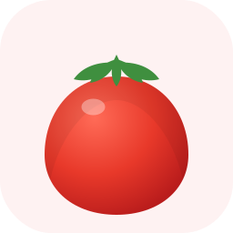
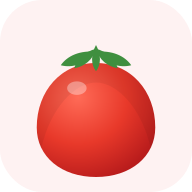

# TOM09S

Étudiant à l'INSA Centre Val de Loire. Je fais des extensions de navigateur, des outils d'IA qui tournent en local et des bases de données ouvertes. Tout est open source.

 

## Organisations

<table>
  <tr>
    <td align="center" width="180"> <b>WikimindAI</b></td>
    <td align="center" width="180"> <b>TheSavageRebels</b></td>
    <td align="center" width="180"> <b>INSA CVL</b></td>
  </tr>
</table>

 

## Projets

<table>
  <tr>
    <td width="110" align="center"></td>
    <td>
      <b>ChromeOptimizer</b> 
      Extension Chrome (Manifest V3) qui libère la mémoire du navigateur : elle met les onglets inactifs en veille, ferme les pages ouvertes en double et allège les pages chargées de publicités. Elle fonctionne aussi sur Edge et Brave, existe en 16 langues et ne fait qu'une requête réseau par jour. Les mesures de performance sont publiques, avec la méthode et les données brutes. 
      <a href="https://chromewebstore.google.com/detail/chromeoptimizer-gestionna/naefoklnpmljhohogkhabjdcdhlkcdog">Chrome Web Store</a> · <a href="https://chpalitom09-bot.github.io/ChromeOptimizer/">Site</a> · <a href="https://chpalitom09-bot.github.io/ChromeOptimizer/benchmark.html">Benchmark</a> · <a href="https://github.com/chpalitom09-bot/ChromeOptimizer">Code</a>
    </td>
  </tr>
  <tr>
    <td width="110" align="center"></td>
    <td>
      <b>Wikimind AI</b> &nbsp; WikimindAI 
      Espace de travail IA que l'on peut adapter à ses usages : plusieurs modèles interchangeables, mémoire persistante, connecteurs Google Workspace, génération d'images, flashcards et quiz pour réviser, graphiques interactifs, rendu LaTeX et mode code. Le projet dépasse les 240 000 lignes de code. 
      <a href="https://wikimindai.github.io/Wikimind/">Site</a> · <a href="https://github.com/WikimindAI/Wikimind">Code</a>
    </td>
  </tr>
  <tr>
    <td width="110" align="center"></td>
    <td>
      <b>SomeCode</b> 
      Éditeur de code pour Windows, construit avec Electron et Monaco. Pas d'IA intégrée et pas de télémétrie : un éditeur qui fait son travail et rien d'autre.
    </td>
  </tr>
  <tr>
    <td width="110" align="center">
      <picture>
        <source media="(prefers-color-scheme: dark)" srcset="./assets/projects/localllm-dark.png">
        
      </picture>
    </td>
    <td>
      <b>LocalLLM</b> &nbsp; WikimindAI 
      On renseigne son GPU, son CPU, sa RAM et son SSD, et le site indique la classe de modèles que la machine peut faire tourner, avec les liens et les tailles des fichiers GGUF. 25 modèles référencés, sous licence MIT. 
      <a href="https://wikimindai.github.io/LocalLLM/">Site</a> · <a href="https://github.com/WikimindAI/LocalLLM">Code</a>
    </td>
  </tr>
  <tr>
    <td width="110" align="center"></td>
    <td>
      <b>Open Food Calories</b> 
      Base JSON de plus de 5 000 aliments, plats et ingrédients, avec calories et macronutriments, en français et en anglais. Chaque entrée est validée par un schéma et recoupée avec les valeurs de référence CIQUAL et USDA. Elle s'utilise en JSON brut, en paquet pip, en ligne de commande ou via une API REST locale. 
      <a href="https://chpalitom09-bot.github.io/Open-food-calories/">Démo</a> · <a href="https://github.com/chpalitom09-bot/Open-food-calories">Code</a>
    </td>
  </tr>
  <tr>
    <td width="110" align="center"></td>
    <td>
      <b>Wikimind Food API</b> &nbsp; WikimindAI 
      API qui expose les données nutritionnelles de la base CIQUAL 2025, hébergée sur Firebase et GitHub Pages. 
      <a href="https://github.com/WikimindAI/wikimind-food-API">Code</a> · <a href="https://github.com/WikimindAI/ciqual-api">ciqual-api</a>
    </td>
  </tr>
  <tr>
    <td width="110" align="center"></td>
    <td>
      <b>TomatoList</b> 
      Recensement collaboratif de variétés de tomates, avec un assistant IA branché sur un worker Cloudflare. 
      <a href="https://chpalitom09-bot.github.io/TomatoList/">Site</a> · <a href="https://github.com/chpalitom09-bot/TomatoList">Code</a>
    </td>
  </tr>
  <tr>
    <td width="110" align="center"></td>
    <td>
      <b>Pépins de tomates</b> 
      Catalogue de variétés de tomates avec des fiches détaillées (couleur, poids, pays d'origine), un panier et la commande. 
      <a href="https://chpalitom09-bot.github.io/pepinsdetomates/">Site</a> · <a href="https://github.com/chpalitom09-bot/pepinsdetomates">Code</a>
    </td>
  </tr>
  <tr>
    <td width="110" align="center"></td>
    <td>
      <b>ColorWeb</b> 
      Pipette à couleurs pour Chrome. Une loupe suit le curseur et grossit les pixels, un clic copie le code couleur en HEX, RGB ou HSL. Moins de 200 lignes de JavaScript, aucune dépendance, aucune requête réseau. 
      <a href="https://github.com/chpalitom09-bot/ColorWeb">Code</a>
    </td>
  </tr>
</table>

Je contribue aussi à [Pollinations](https://github.com/pollinations/pollinations), la plateforme open source d'IA générative.

 

## API et services d'IA

Ce que j'ai déjà branché dans mes projets, Wikimind en tête.

<table>
  <tr>
    <td align="center" width="130"> Pollinations</td>
    <td align="center" width="130"> Mistral</td>
    <td align="center" width="130"> Groq</td>
    <td align="center" width="130"> Cerebras</td>
    <td align="center" width="130"> SambaNova</td>
    <td align="center" width="130"> Cohere</td>
  </tr>
  <tr>
    <td align="center"> OpenRouter</td>
    <td align="center"> Gemini API</td>
    <td align="center"> NVIDIA NIM</td>
    <td align="center"> Tavily</td>
    <td align="center"> Brave Search</td>
    <td></td>
  </tr>
</table>

 

## Outils

<table>
  <tr>
    <td align="center" width="130"> GitHub</td>
    <td align="center" width="130"> Firebase</td>
    <td align="center" width="130"> Cloudflare</td>
    <td align="center" width="130"> Extensions Chrome</td>
    <td align="center" width="130"> Electron</td>
    <td align="center" width="130"> Node.js</td>
  </tr>
  <tr>
    <td align="center"> Python</td>
    <td align="center"> JavaScript</td>
    <td align="center"> PyTorch</td>
    <td align="center"> Kaggle</td>
    <td align="center"> Hugging Face</td>
    <td></td>
  </tr>
</table>

 

  
  

